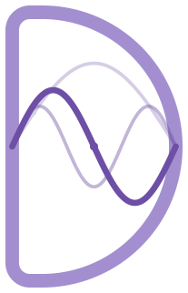

<h1 align="center"><br/>PhysDesignBench</h1>

<p align="center"><em>Can AI agents turn engineering specifications into working physical designs?</em></p>

<p align="center">
PhysDesignBench evaluates AI agents on physics-based engineering design. Agents use simulation tools to design and optimize physical devices; their final submissions are independently rebuilt and checked against engineering constraints and performance objectives.
</p>

## Links

- [Website](https://physdesignbench.com)
- [Leaderboard](https://physdesignbench.com/leaderboard)
- [Tasks](https://physdesignbench.com/tasks)
- [Explore results](https://physdesignbench.com/extended)
- [Run the benchmark](https://physdesignbench.com/run)
- [Citation (BibTeX)](https://physdesignbench.com/citation.bib)

## Benchmark

The paper evaluates **26 tasks**: 16 Design tasks and 10 Reimplementation tasks.

Agents work with domain-specific simulators under fixed time and evaluation budgets. The benchmark reports the **mean normalized score (MNS)** of final submissions and **engineering pass rate (EPR)**, which measures how often final designs meet the selected performance targets.

For task specifications, design examples, and results, see the [website](https://physdesignbench.com).

## Running the benchmark

See the [run guide](https://physdesignbench.com/run) for environment setup and execution instructions.

## Contributing

We welcome new design problems, expert reviews, and evaluations of additional agents.

Read the [contribution guide](docs/contributing/README.md) for task requirements and the submission process, or [propose a task](https://github.com/Physics-Automation/physdesignbench/issues/new/choose).

## Contributors

We acknowledge the researchers who develop PhysDesignBench, contribute tasks, and review their scientific and engineering validity.

<table>
  <tr><th colspan="2" align="left">Core Contributors</th></tr>
  <tr>
    <td width="50%"><a href="https://ch.linkedin.com/in/ali-momeni-3029b6a3">Ali Momeni</a></td>
    <td width="50%"><a href="https://babak70.github.io/">Babak Rahmani</a></td>
  </tr>
  <tr><th colspan="2" align="left">Advisory</th></tr>
  <tr>
    <td><a href="https://qc.ethz.ch/the-center/person-detail.dnorris.html">David Norris</a></td>
    <td><a href="https://people.epfl.ch/romain.fleury?lang=en">Romain Fleury</a></td>
  </tr>
  <tr><th colspan="2" align="left">Task Contributors</th></tr>
  <tr>
    <td><a href="https://www.epfl.ch/labs/lwe/page-142114-en-html/">Jiahui Wang</a></td>
    <td></td>
  </tr>
  <tr><th colspan="2" align="left">Scientific Reviewers</th></tr>
  <tr>
    <td><a href="https://www.epfl.ch/labs/lwe/page-142114-en-html/">Jiahui Wang</a></td>
    <td><a href="https://people.epfl.ch/amir.jafargholi?lang=en">Amir Jafargholi</a></td>
  </tr>
</table>

## Citation

If you use PhysDesignBench in your research, please cite:

```bibtex
@misc{momeni2026physdesignbench,
  author = {Ali Momeni},
  title = {PhysDesignBench: Evaluating AI Agents on End-to-End Physics-Based Engineering Design},
  year = {2026},
  url = {https://physdesignbench.com},
  note = {Preprint}
}
```
